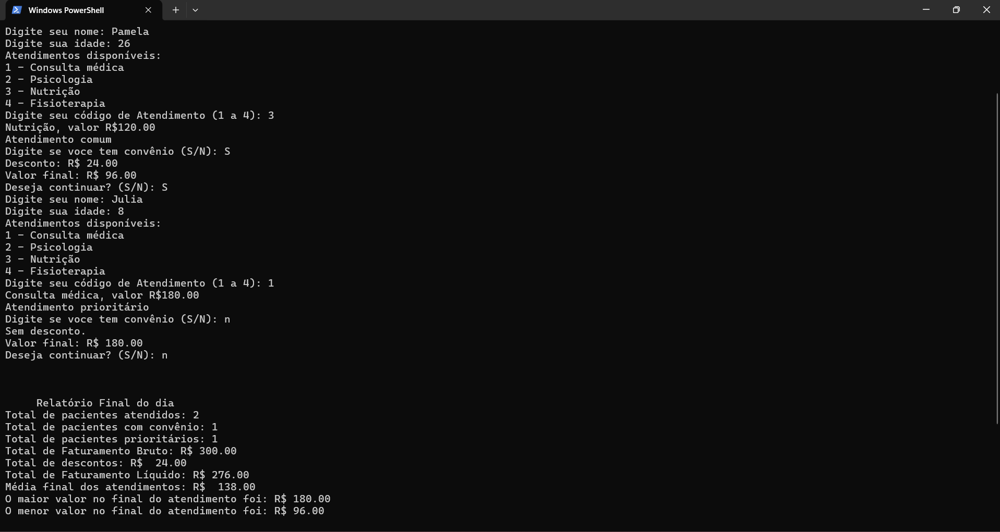

# Sistema de Controle de Clínica

Projeto desenvolvido em Python para simular o controle de atendimentos em uma clínica.

O programa permite informar dados do paciente, escolher o tipo de atendimento e consultar os valores dos serviços disponíveis.

## Funcionalidades
\- Cadastro de pacientes e escolha de atendimento  
\- Identificação de atendimento prioritário por idade  
\- Descontos para pacientes com convênio  
\- Cálculo do valor final de cada atendimento  
\- Relatório com pacientes atendidos, faturamento, descontos, média, maior e menor valor

## Tecnologias 

- **Python**

## Aviso

Este projeto é uma simulação para fins de estudo. Todos os dados usados são fictícios.

## Como executar
1. Baixe o arquivo do projeto.  
2. Abra o terminal na pasta onde o arquivo foi salvo.  
3. Execute o comando: `python sistemacontroleclinica.py`
4. Siga as instruções exibidas na tela.

## Exemplo de uso

## Autora

Pamela Barbosa P Ramos

## Melhorias futuras

- Salvar os atendimentos em um arquivo
- Adicionar mais tipos de atendimento
- Criar uma interface gráfica

